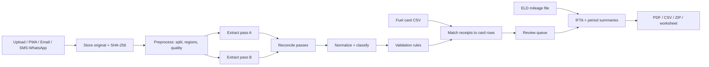

# Architecture

**Approach:** Build one complete vertical slice before adding all modules.

## Recommended stack (temporary default)
Matches a stack the founder already runs in production (TypeScript, Next.js, Express/Prisma, Postgres, Redis, Railway/Vercel), so it is cheap to operate and easy to maintain. Change only with a written trade-off.

| Layer | Choice |
| --- | --- |
| frontend | Next.js (App Router) + TypeScript + Tailwind, installable PWA, i18n library (e.g. next-intl). |
| api | Node.js + TypeScript (Express or Next route handlers), Zod for validation. |
| database | PostgreSQL + Prisma; row-level company scoping enforced in a data-access layer and tested. |
| queue | Redis + BullMQ for extraction, matching and report jobs; idempotency keys per document/pass. |
| storage | S3-compatible object storage (e.g. Cloudflare R2 or S3) with versioning and signed URLs. |
| ai | Anthropic Claude vision models via server-side API for pass A; pass B via a second prompt/model or OCR + parse. Model IDs in env vars. |
| messaging | Twilio for SMS/WhatsApp; an inbound-email provider (e.g. Resend/Postmark inbound) for forwarding. |
| pdf | HTML templates rendered to PDF with Playwright/Chromium for consistent professional layout. |
| observability | Sentry for errors; structured logs without document contents. |
| hosting | Railway (API, workers, Postgres, Redis) + Vercel (web), or a single provider if simpler. |

## Repo layout (proposed)
```
apps/
  web/            Next.js app (UI, PWA, i18n)
  api/            REST API (or Next route handlers) — auth, CRUD, uploads, webhooks
  worker/         BullMQ workers: preprocess, extract-a, extract-b, reconcile, validate, match, report
packages/
  db/             Prisma schema, migrations, seed (Demo Freight LLC)
  core/           Pure domain logic: normalization, validation rules, matching, IFTA math (no I/O, fully unit-tested)
  extraction/     Prompts, JSON schema, model clients, golden-set evaluator
  reports/        HTML templates → PDF (Playwright), CSV, ZIP
  i18n/           en, so strings
docs/
```

## Data flow


## Job pipeline
Each step is an idempotent BullMQ job keyed by `documentId + step + version`. Re-running a step with the same versions produces no duplicate rows.

## Requirements
- Keep ingestion, extraction, validation, calculations, reporting, and UI as separable components.
- Prevent duplicate processing where possible through idempotent workflows.
- Test rounding, duplicates, missing fields, and conflicting records.
- Document local setup, environment variables, database migrations, and deployment.
- Choose a maintainable technology stack based on cost, skills, security, and deployment requirements; explain trade-offs before committing.
- Use decimal math libraries for money and gallons; never JavaScript floats.
- Version every rule, prompt and rate table; store versions on the records they produced.
- Make every deliverable reproducible from its snapshot id.
- Startup preflight checks: verify each external credential (AI, storage, messaging, email) and fail loudly with a readable error.
- Verify features on the deployed environment, not only locally; document which branch deploys where.

## Cost controls
- Log tokens and cost per extraction run; show cost per document and per company in an admin view.
- Skip pass B for fields already corroborated by a fuel card row, when configured.
- Downscale images to the smallest resolution that keeps accuracy on the test set.
- Cache station-directory lookups; never re-extract an unchanged document (hash check).
- Monthly AI budget cap per environment with alerts at 50/80/100%.
