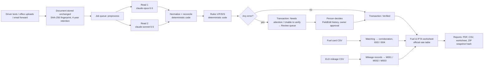

# How the system works — front and back

For the Sahid Freight team. Part 1 is for everyone: what people see and do. Part 2 is what happens
behind each screen. Part 3 is for whoever runs or maintains the system. Everything here describes what
is live as of 9 November 2026, not what is planned; planned work is listed at the end.

---

## Part 1 — In front: what people see and do

### 1.1 The promise

A small trucking company takes photos of fuel receipts. We read them, check them, match them against the
fuel card statement and the truck's mileage, and produce the quarter's IFTA fuel-tax numbers and the
paperwork a preparer or auditor needs. The owner only has to decide the handful of items a machine should
not decide alone.

### 1.2 Who uses it

| Person | Where | What they do |
|---|---|---|
| Driver | Phone (text message, or the capture app) | Snaps a receipt and sends it. Answers "Which truck?" when asked. |
| Office staff / bookkeeper | Web dashboard | Uploads batches, works the Review queue, imports fuel card and ELD files, generates reports. |
| Reviewer (outside bookkeeper) | Web dashboard | Works the Review queue. Changes to important values wait for the owner's approval. |
| Owner | Web dashboard | Everything above, plus approving reviewer changes and managing the team. |
| Platform admin (us) | API | Loads official rate tables, supports companies. |

### 1.3 The eight screens

| Screen | Purpose |
|---|---|
| **Home** | What needs you today, the next IFTA deadline, documents received, share verified, one recommended next step, the setup checklist. |
| **Inbox** | Every document that arrived, with its fingerprint, channel, sender and status. Drag-and-drop upload. |
| **Transactions** | The ledger: one row per receipt read, with both reads shown side by side and a change history. |
| **Review** | Only the receipts that failed a check, sorted by deadline. One-click decisions. Owner approvals. |
| **Fuel & IFTA** | Fuel by state, mileage by jurisdiction, fuel-card and ELD imports, the quarter's worksheet. |
| **Reports** | Period PDF, transactions CSV, IFTA worksheet, supporting ZIP. Each stamped with its data snapshot. |
| **Vehicles & Drivers** | Trucks (unit number, tank, ELD provider) and drivers (phone, usual truck). |
| **Settings** | Company record, the receipt-forwarding email address, the team and roles, theme, language. |

The full click-by-click guide is `docs/how-to-use/README.md`; the narrated video is next to it.

### 1.4 The four rules users can rely on

1. **Nothing is invented.** A value that cannot be read stays empty and is flagged. The two reads must agree or a person must confirm.
2. **Nothing is overwritten.** Every correction is a new history entry with the old value, the new value, who and why.
3. **No rate is estimated.** IFTA tax rates come only from the official quarterly table loaded into the system.
4. **Nothing is filed, sent, paid or deleted without a person's approval.** Reports stay labelled *Preliminary* until the period is reviewed.

---

## Part 2 — Behind each screen: what actually happens

### 2.1 A receipt's journey, in one picture

### 2.2 Intake: how a document arrives

- **Web upload** (live): files go to the API, which checks type and size (PDF, JPG, PNG, HEIC, TIFF, CSV, XLSX; 25 MB), computes the SHA-256 fingerprint, stores the original in object storage under an immutable key, and writes a `Document` row with channel, uploader, received time and a retention date four years out.
- **Duplicate detection**: a second upload with the same fingerprint for the same company is stored (nothing is refused) but marked *Duplicate of an earlier upload* and never read again.
- **Email forwarding** and **text messages**: each company has an address (`docs+<slug>@sahidfreight.com`) and drivers are registered by phone number. The attribution rules exist; the receivers that turn an inbound email or SMS into a document are the next build (see Part 4). Today those channels are shown in the UI but documents arrive through the web upload and the mobile app.
- **Mobile capture app** (Expo, test distribution): camera capture, "Which truck?" prompt, offline queue that uploads when the phone reconnects. Same API, same pipeline.

### 2.3 Reading: two independent reads, then code

Reading is a chain of four **jobs** in a Postgres-backed queue. Each job has a key
`<documentId>:<step>:<pipelineVersion>`; enqueueing the same key twice is a no-op, so retries and
re-uploads never do double work. Workers claim jobs with `FOR UPDATE SKIP LOCKED`, so several worker
processes can run at once.

| Step | What it does |
|---|---|
| `preprocess` | Marks the document as processing. (Page splitting and image-quality scoring are planned here.) |
| `extract-a` | Sends the image to the first model (`claude-opus-5-5`) with the "careful data-entry clerk" prompt. The model returns strict JSON: every field with its printed text, normalized value and a legibility grade (clear / partial / unreadable), plus each line item. |
| `extract-b` | Sends the same image to a second model (`claude-sonnet-5-5`) with a different "auditor" prompt. Read B never sees Read A. |
| `reconcile` | Deterministic code. Normalizes both reads (dates, numbers, units, categories), compares them field by field, builds the transaction, runs the rules, sets the status, and refreshes open flags. |

What the models are allowed to do: **transcribe**. They copy what is printed into a fixed schema. They
do not add, compute, classify for tax purposes, or decide anything. All arithmetic, comparison, rules
and IFTA math are ordinary code with unit tests.

Key reading rules baked into the prompts:
- Return `null` for anything not clearly printed. Never infer or round.
- Dates on North American receipts are month/day/year unless the paper shows otherwise.
- Reefer fuel, DEF, fees, discounts and credits are separate line categories from motor fuel.

Every read is stored as an `ExtractionRun` (model, prompt version, raw response, tokens, cost, latency)
with one `ExtractedField` per field, including the bounding box where the value was read. That is what
lets the Review screen highlight a field on the receipt image.

**Reconciliation** marks each field *both agree*, *read 1 only*, *read 2 only*, or *reads differ*. A
disagreement on a material field (date, state, total, currency, vendor, or a line's gallons or amount)
leaves the final value empty and raises an error flag; a person must choose.

**Cost control**: each run records its cost from the provider's published prices (integer math, no
floats). A monthly budget (`AI_MONTHLY_BUDGET_USD`) stops model calls when exhausted; documents then
wait in *Processing* rather than being read badly.

### 2.4 Rules: what gets flagged

Rules are pure functions over a transaction and its context (period, truck, fleet mileage, similar
transactions, company settings). Each produces a flag with a code, severity, message, the fields
involved and the evidence. Severity decides status: any open **error** makes the transaction *Needs
attention*; an unreadable required field makes it *Unable to verify*; otherwise it is *Verified*.

| Family | Codes | Checks |
|---|---|---|
| Validity | V001 required fields present · V002 unit on receipt · V003 purchaser on receipt · V004 date valid and in period · V005 state is an IFTA jurisdiction · V006 partial legibility · V007 image quality · V010 reads disagree on a material field | Is the receipt complete and readable, and do the two reads agree? |
| Figures | F001 gallons × price = line amount · F002 lines sum to total · F003 diesel price plausible · F004 gallons within tank capacity · F005 reefer/DEF present (info) · F006 litres or non-USD converted | Does the arithmetic hold and are the numbers plausible? |
| Duplicates | D002 same vendor and date, near-identical gallons and total | Is this the same purchase twice? |
| Attribution | S001 nothing ties the document to a truck | Which truck was it? |
| Fuel card | I003 card row without receipt · I004 card-paid receipt without card row · D003 corroborated (info) | Does the card statement back the receipts? |
| Mileage | M001 fuel but no miles for the truck · M002 fuel in a state with zero miles · M003 fleet MPG outside the band · M004 odometer not increasing | Do fuel and miles agree? |
| Governance | R001 reviewer changed a material value, awaiting owner · I001 rate table missing | Who approved what, and can the worksheet be computed? |

Every rule carries a version, stored on the flag it produced, so results can be explained later even
after a rule changes.

### 2.5 Review: human decisions, recorded

- Opening an item **claims** it (others see who is on it) and starts a reviewer timer (`ReviewSession`).
- Each decision (use read 1, use read 2, type a value, mark unreadable, mark a flag fixed, accept as is) writes a `FieldEdit` with old value, new value, reason and user **before** the column changes. The two original reads are never touched.
- A **reviewer's** change to a material field is applied at once but opens an `Approval` and flag R001; the **owner** approves or rejects. A rejection reverts through a second `FieldEdit`, so the history shows the whole story.
- After each decision the status is recomputed from the open error flags. When the last error is settled the record turns *Verified* and leaves the queue.
- **Re-read receipt** re-queues both reads under the current pipeline version. It is refused with a clear message if a person has already corrected the transaction, so human work is never overwritten by a machine.
- The queue's deadline is one business day from receipt; items are sorted by it.

### 2.6 Fuel card statements

The CSV is parsed with a saved column mapping per provider (Comdata, WEX/EFS, AtoB, TCS, generic); the
system guesses from the headers and remembers corrections. Each row becomes a `FuelCardTransaction`.
The matcher pairs card rows with receipts using date window, amount, gallons and truck, within
tolerances stored in company settings. A pair writes a `Match` (score, fields used, rule version) and
marks the transaction *receipt and card* corroborated. Unmatched card rows raise I003; unmatched
card-paid receipts raise I004; both resolve automatically when a later import or receipt matches.
Card rows are evidence only: they never create a fuel purchase and are never counted as one.

### 2.7 ELD mileage

The CSV (long layout: one row per truck and state; or wide: one row per truck, one column per state;
miles or kilometres) is validated completely before anything is written. Unknown trucks stop the
import with a list. A newer file for a truck **supersedes** that truck's earlier rows for the period;
superseded rows are kept, never deleted. After an import, every fuel transaction of the period is
re-checked (M001, M002), fleet MPG is recomputed (M003), and statuses refresh.

### 2.8 The IFTA worksheet

Inputs per period: active mileage records inside the period; `MOTOR_FUEL` lines only (reefer fuel and
DEF are excluded by category); the `IftaRate` rows for the quarter and fuel type.

Per jurisdiction: taxable miles → consumed gallons at fleet MPG → minus tax-paid gallons → net gallons
→ × rate → tax due (negative is a credit). Everything is `Decimal`; rounding is documented in the
*Formulas and rounding* panel. If no rate table exists for the quarter the worksheet is blocked with
I001; rates are never estimated. The status is **Reviewed** only when the period is approved and no
open error touches it; otherwise **Preliminary**, and every output carries *Prepared for review by a
qualified preparer; not a filed return.*

Rate tables ship with the release as `apps/api/rates/<quarter>-<fuelType>.csv`, read from the official
iftach.org matrix, each with its source URL and version; they load at boot and never override a table a
platform admin loaded by hand. The 2026Q4 table covers the 47 U.S. jurisdictions in the matrix; Canadian
provinces show no rate yet.

### 2.9 Reports

Four deliverables, all built from the same loaders:

- **Transactions CSV** (31 fixed columns) and **IFTA worksheet CSV**: pure, timestamp-free text, so the same data always produces the same bytes.
- **Period PDF**: cover, summary, fuel by state, mileage and MPG by truck, non-fuel spend, exceptions, reconciliation notes, the worksheet, a transaction appendix, footer on every page.
- **Supporting ZIP**: every original renamed `<date>_<state>_<vendor>_<txid>.<ext>`, `index.csv`, the CSVs, the PDF, and a manifest of every file's SHA-256.

Each `Report` row stores the **snapshot hash** of its contents, so any file can be regenerated and
proven identical. Files are labelled Preliminary or Reviewed to match the period.

### 2.10 What is written down about every action

An append-only `AuditLog` (database triggers forbid update and delete) records logins and failed logins,
uploads, document views, edits, approvals, exports, deletion requests, break-glass access, company
creation, team changes and re-reads, with the user, company and time.

---

## Part 3 — Underneath: for whoever runs it

### 3.1 Components

| Component | Technology | Where it runs |
|---|---|---|
| Web dashboard (`apps/web`) | Next.js (App Router), TypeScript, Tailwind; English and Somali | Vercel, `www.sahidfreight.com` |
| API (`apps/api`) | Node + Express + TypeScript, Zod validation, Prisma | Railway service `sahid-freight` |
| Worker (`apps/api/src/worker.ts`) | Same code, started with `SERVICE_ROLE=worker`; polls the job queue, serves `/health` | Railway service `worker` |
| Database | PostgreSQL (Prisma migrations, additive only) | Railway |
| Document storage | Amazon S3 bucket `sahidfreight-docs` (eu-north-1), signed URLs | AWS |
| Reading models | Anthropic Claude via the server-side API: `claude-opus-5-5` (read 1), `claude-sonnet-5-5` (read 2); model IDs in env | Anthropic |
| Mobile capture (`apps/mobile`) | Expo / React Native, package `com.sahidfreight.app` | Test distribution |
| Shared logic (`packages/core`, `packages/extraction`, `packages/i18n`) | Pure TypeScript: rules, matching, IFTA math, normalization, prompts, golden set, strings | Bundled into API and web |

### 3.2 Security model

- **Authentication**: email or phone + password, with email one-time codes for sign-up and reset; JWT access tokens with refresh tokens. Helmet, CORS allow-list and rate limiting on the API.
- **Tenancy**: every back-office route is mounted under `/companies/:companyId` and passes `requireCompany(...roles)`, which checks the caller's `Membership` for that company. Every data query goes through a tenant client scoped by company. Tests assert that cross-company access fails.
- **Roles**: OWNER, STAFF, DRIVER, REVIEWER, PARTNER, ADMIN per company membership; platform ADMIN for rate tables and support. A break-glass path exists for admins and is audited.
- **Documents**: served only through short-lived signed URLs; no public bucket. Originals are written once under immutable keys.
- **Retention**: a database trigger refuses to delete a document inside its four-year retention window; deletion is a `DeletionRequest` that waits. The audit log cannot be updated or deleted.
- **Secrets**: only in the hosting providers' environment settings; never in git, chat or browser code. The API runs a preflight at boot that verifies each credential (database, storage read/write/delete, AI key, messaging) and refuses to start in production if one is missing.
- **Data**: money and gallons are `Decimal` end to end; no JavaScript floats touch them.

### 3.3 Environments and deploy

- Branch `backoffice` is the live product. `newmain` holds the retired marketplace (tag `marketplace-final`).
- API and worker: build locally (`npm run build` in `apps/api`), then `railway up --service sahid-freight --detach` and `railway up --service worker --detach --path-as-root .`. Migrations run at API start.
- Web: `vercel --prod --yes --archive=tgz` from the repo root.
- Nothing deploys without Amin's explicit "Deploy it". Full notes in `docs/DEPLOY.md`.
- Local development uses a local Postgres and local disk storage; `scripts/seed-golden-quarter.ts` replays the 20 fictional golden receipts through the real pipeline with a fake reader so a full quarter exists without an AI key.

### 3.4 Testing

- Rules, matching, IFTA math, normalization and reconciliation have unit tests (`packages/core`, `packages/extraction`).
- The API has integration tests on a local Postgres, including the full pipeline on golden receipts, tenant isolation, reprocessing and rate-table loading.
- A golden set of 20 fictional receipts (`packages/extraction/golden`) covers clean, faded, angled, crumpled, reefer + tractor, DEF, litres/CAD, missing unit, duplicate, refund, card fee, unreadable gallons, multi-receipt photo and multi-page PDF, each with its expected JSON.
- The rule: a feature counts as working only when it is implemented, tested locally, and verified on the deployed environment.

### 3.5 Versioning

Prompts (`a-v2`, `b-v2`), the pipeline (`v2`), each rule, and each rate table (`# version=`) carry a
version that is stored on the rows they produced. A change to any of them is a new version; old rows keep
the version that made them, so every number can be explained later.

---

## Part 4 — Not yet built, and known limits

- **Email and text-message receivers**: the addresses and attribution rules exist; the inbound handlers that turn an email or SMS into a document are the next build.
- **Preprocessing**: page splitting, receipt region detection and image-quality scoring are stubs; multi-receipt photos and multi-page PDFs are handled by the readers today.
- **Mobile app** is in test distribution, not in the stores.
- **Rate tables**: Canadian provinces are not in the bundled table; mid-quarter rate changes (e.g. Ohio) and Indiana's surcharge need confirmation. The 2026Q4 matrix is preliminary until 4 December 2026.
- **XLSX imports** are not read yet; export to CSV first.
- **Home vs Review counts**: Home counts all open flags including warnings on verified receipts; the Review queue lists only transactions with open errors. They should be aligned.
- **Operations**: database backups and restore drills, error alerting, and AI-spend alerts at 50/80/100% are planned, not in place.
- **Billing** is not built.

---

## Glossary

- **Document**: a file as received (photo, PDF, CSV). **Transaction**: what a receipt says, as a ledger row.
- **Read 1 / Read 2** (pass A / pass B): the two independent model transcriptions of a receipt.
- **Reconcile**: the code step that compares the reads and builds the transaction.
- **Flag / Issue**: a rule result on a transaction, with a code like V001.
- **Verified / Needs attention / Unable to verify**: the three transaction statuses.
- **Corroboration**: single source, two reads agree, receipt and card, or human-confirmed.
- **Snapshot hash**: SHA-256 of a report's contents; proves it can be regenerated identically.
- **IFTA**: International Fuel Tax Agreement; one quarterly return, tax distributed by miles per jurisdiction.
