# Sahid Freight Back Office — How to use

A complete guide for owners, office staff and reviewers of a small carrier. It covers the web
dashboard at **www.sahidfreight.com**, from the first sign-in to handing a finished quarter to your
IFTA preparer.

The screenshots show the fictional **Demo Freight LLC**. The narrated video version of this guide is
`how-to-use.mp4` in this folder; its script is `narration.md`.

---

## 1. What it does, in one paragraph

Receipts come in: dropped on the Inbox, texted by a driver, or forwarded by email. Every document is
fingerprinted and stored unchanged for four years. The system reads each receipt **twice**, with two
independent reads, and runs the result through a fixed set of rules. A value is final only when both
reads agree or a person confirmed it. Anything the rules flag waits in **Review**, where you accept,
correct or mark it unreadable. Verified fuel purchases, your fuel card statement and your ELD mileage
come together in **Fuel & IFTA**, where the quarter's worksheet is calculated from the official rate
table. **Reports** produces the files you hand to your preparer.

Four rules hold everything together:

- **Nothing is invented.** A value that cannot be read stays empty and is flagged.
- **Nothing is overwritten.** Every correction is a new entry in the change history; the original read is kept.
- **No rate is ever estimated.** Tax rates come only from the official quarterly table loaded into the system.
- **Nothing is filed, sent, paid or deleted without your approval.** The worksheet and reports are labelled *Preliminary* until a person has reviewed the period.

---

## 2. Who does what

| Role | Can | Typical person |
|---|---|---|
| **Owner** | Everything, including approving corrections to material values and managing the team | The carrier's owner |
| **Office staff** | Upload, review, correct, import statements, generate reports | Dispatcher or bookkeeper |
| **Reviewer** | Work the Review queue; material changes wait for the owner's approval | Outside bookkeeper or a reviewer you hire |
| **Driver** | Send receipts (text, photo, upload); see what they sent | Each driver |

Add people under **Settings → Team**. Each person needs a Sahid Freight account with that email first.

---

## 3. Signing in

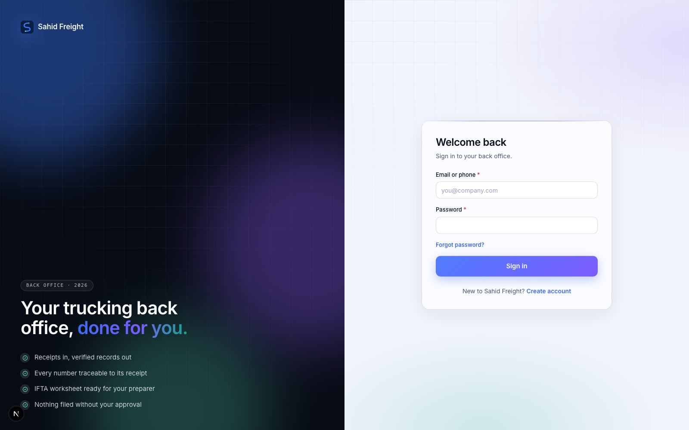

Go to **www.sahidfreight.com**, enter the email or phone on your account and your password. Use the
reset link under the form if you forget it. Every change in the system is recorded under the person
who made it, so each person should use their own login.

---

## 4. Home

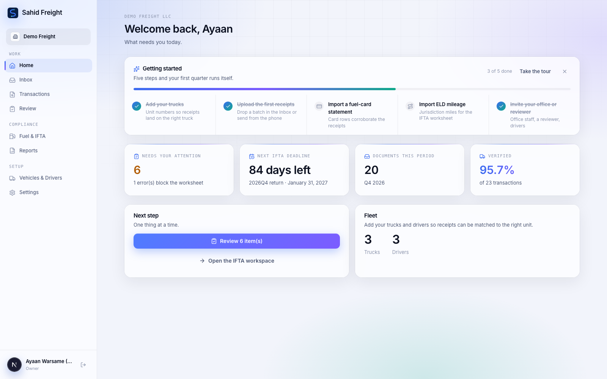

Home is the daily starting point.

- **Getting started** walks a new company through five setup steps: trucks, first receipts, fuel-card statement, ELD mileage, team. It disappears once the steps are done, or when you dismiss it.
- **Needs your attention**: open flags, with how many of them are errors that block the worksheet.
- **Next IFTA deadline**: days left and the due date for the current quarter's return.
- **Documents this period** and **Verified**: how much has arrived and how much of it is already confirmed.
- **Next step** recommends the single most useful action right now.
- **Fleet**: trucks and drivers on file.

---

## 5. Setup, once

### 5.1 Vehicles & Drivers

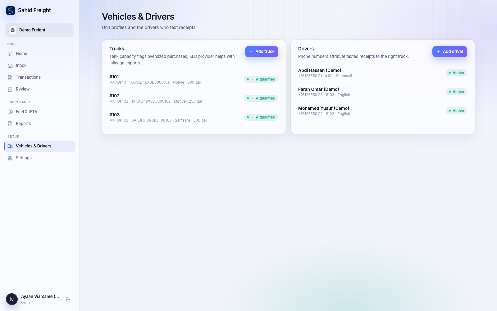

**Trucks.** Add each unit with its unit number, VIN, plate, tank capacity and ELD provider, and tick
*IFTA qualified*. The unit number is how a receipt lands on the right truck. The tank capacity lets
the system flag a fill-up larger than the tank could hold.

**Drivers.** Add each driver with the mobile number they will text receipts from and their usual
truck. A texted receipt is attributed to the driver by phone number, and to their usual truck when
the receipt itself does not print a unit number.

### 5.2 Settings

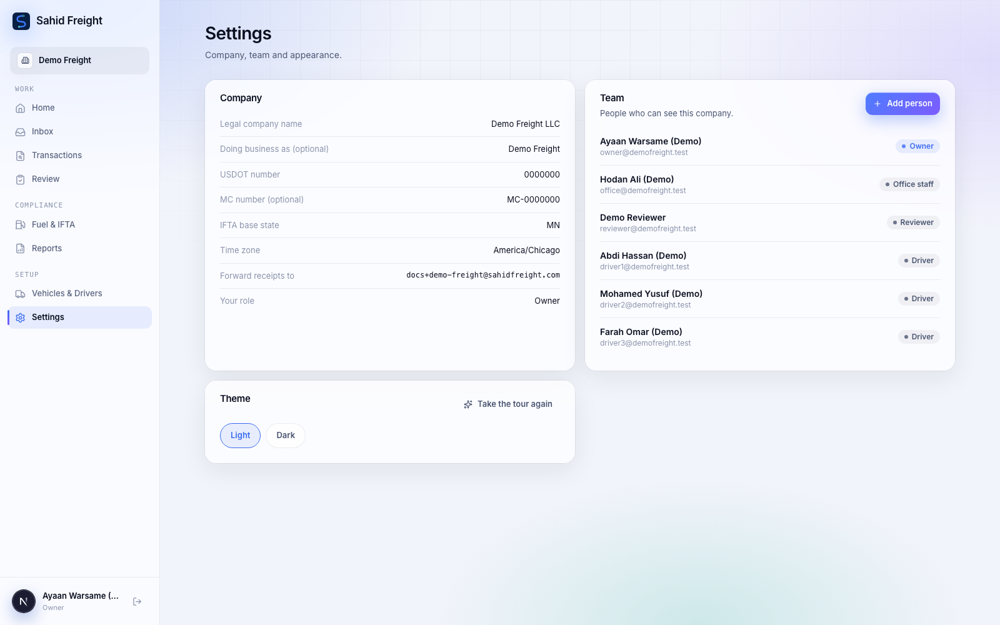

- **Company**: legal name, DBA, USDOT and MC numbers, IFTA base state, time zone.
- **Forward receipts to**: your company's own intake address. Anything emailed to it lands in the Inbox. Give it to drivers and vendors.
- **Team**: who can see this company and their role.
- **Theme**: light or dark. **Take the tour again** replays the two-minute introduction.
- **Language**: English or Somali, per person.

---

## 6. Inbox: getting paperwork in

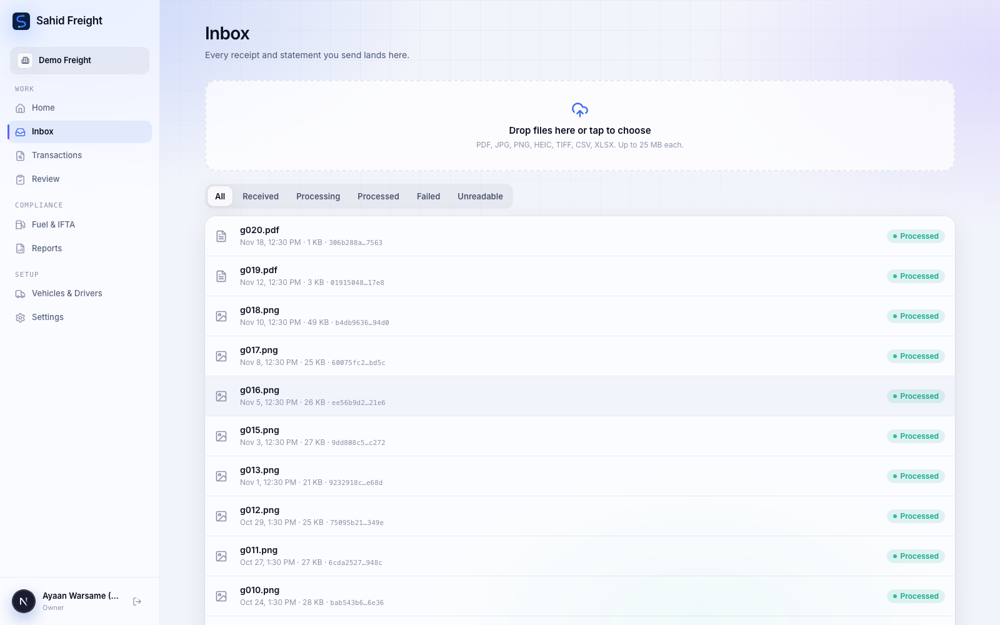

Every receipt and statement arrives here.

**Ways to get a receipt in**

1. **Drag and drop** files onto the dashed area, or tap it to choose files. PDF, JPG, PNG, HEIC, TIFF, CSV and XLSX are accepted, up to 25 MB each. A multi-page PDF and a photo with several receipts in it are both handled: each receipt becomes its own transaction.
2. **Text from a phone.** Drivers send a photo to the company's receipt number; the driver's phone number identifies them.
3. **Email.** Forward to the address shown in Settings.

**What happens to each document**

- It is **fingerprinted** (a SHA-256 hash) and the original is stored exactly as received, for four years.
- If the same file arrives twice, the second is marked **Duplicate of an earlier upload** and is not counted again.
- It is read twice, in the background, usually within a minute. Status moves Received → Processing → Processed. *Unreadable* means neither read could find a receipt in the file; *Failed* means the reader itself failed and the document can be re-read.

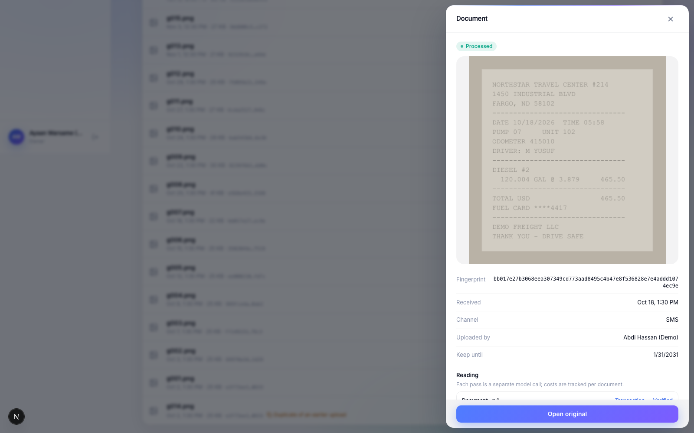

Open a document to see the original image, its fingerprint, when and how it arrived, who sent it,
how long it is kept, the two reads and what they cost, and a link to the transaction that was created.
**Open original** always gives you the untouched file.

---

## 7. Transactions: the ledger

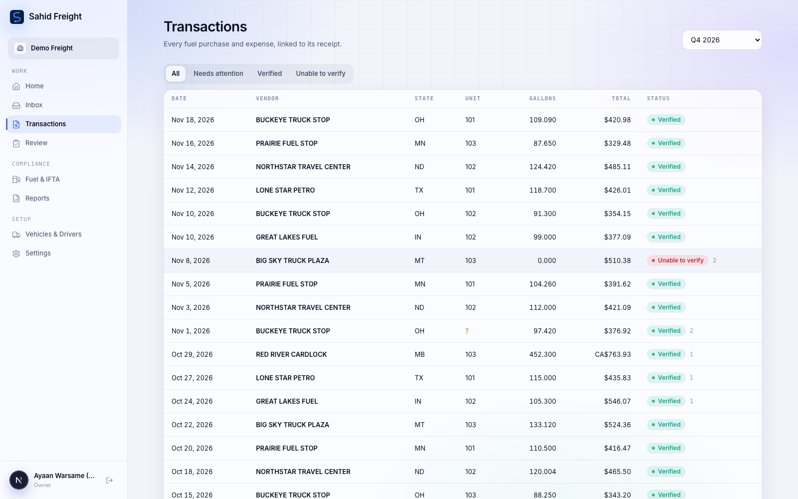

Every receipt that has been read becomes a row: date, vendor, state, truck, gallons, total and status.

- Pick the **period** at the top right. *All periods* also shows receipts whose date could not be read and which therefore have no quarter yet.
- Filter by status. **Verified**: both reads agreed and every rule passed. **Needs attention**: a rule raised an error. **Unable to verify**: a required value is unreadable and a person must supply it.
- The small number next to a status is the count of open flags on that row. A **?** in the Unit column means no truck could be attributed.

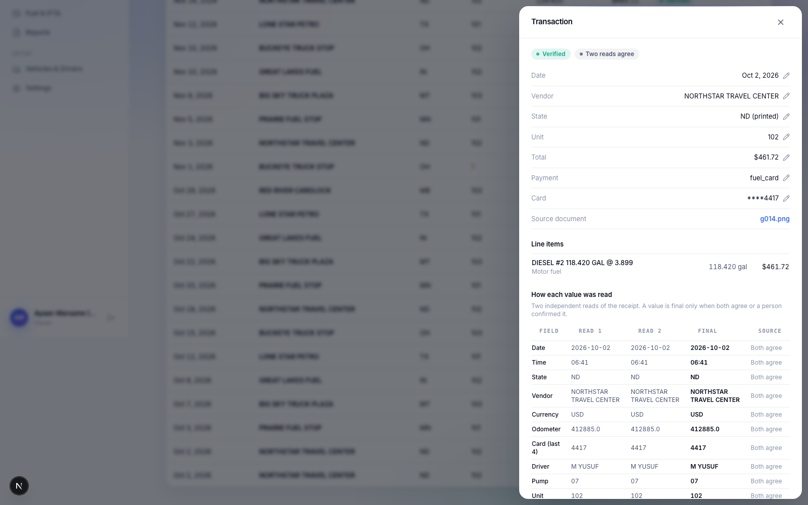

Open a row for the detail drawer:

- The header fields, each with a pencil to correct it. A correction requires a short reason. The original read is kept in **Change history** at the bottom.
- **Line items**: each fuel, DEF, fee or credit line as printed.
- **How each value was read**: Read 1, Read 2, the final value and its source. *Both agree* means the two independent reads matched. If they differ on a material field, the final value stays empty and the receipt is flagged.
- **Open issues** and **Fixed earlier**: current flags, and the ones that have since been resolved.
- **Re-read receipt** (in the Review drawer) runs the document through the current reader again. It is refused if a person has already corrected the transaction, so human work is never replaced.

---

## 8. Review: only what needs you

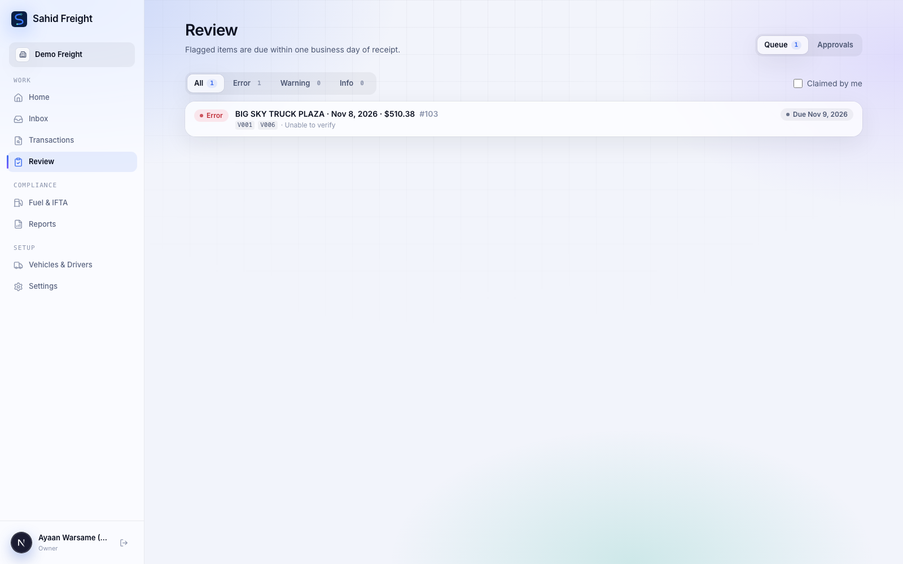

Review lists only the transactions that still have an open **error**, sorted by deadline. Each item is
due within one business day of the receipt arriving. Filter by Error / Warning / Info, and tick
**Claimed by me** to see what you are working on. Opening an item claims it; others see who is on it.

The **Approvals** tab (owners) lists corrections to material values made by a reviewer. Each waits
there until the owner approves it or rejects it with a reason; a rejected change is reverted.

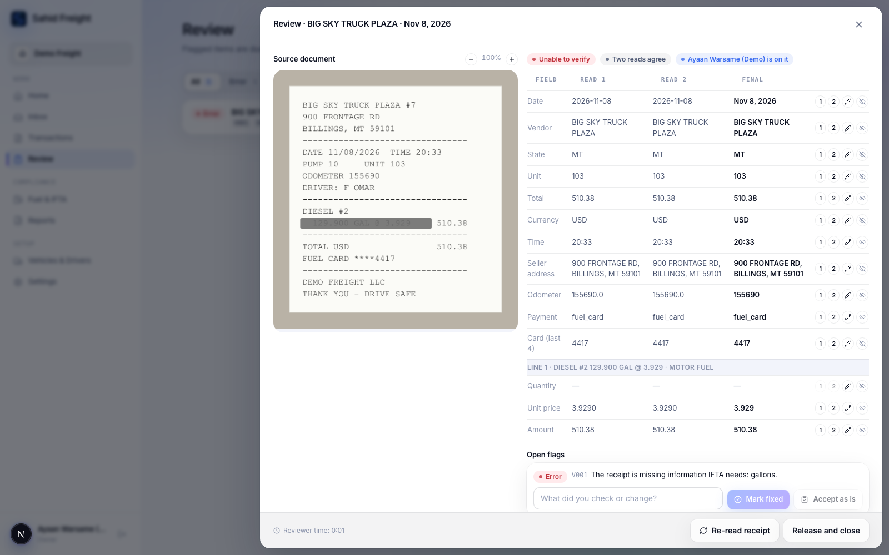

In the workspace the receipt is on the left and both reads on the right.

- Click a field to **highlight where it was read** on the receipt. Zoom with − and +.
- For each field choose **1** (use read 1), **2** (use read 2), the **pencil** (type the value, with a reason) or the **crossed eye** (mark unreadable; the record becomes *Unable to verify* until someone supplies the value).
- Each flag has a note box. **Mark fixed** when you corrected the value. **Accept as is** when the paper is simply right that way. Both are logged with your note.
- **Re-read receipt** sends the document through the reader again. **Release and close** lets someone else pick it up.
- The footer shows **Reviewer time** for the item.

When the last error on a record is settled, it turns **Verified** and leaves the queue.

### 8.1 What the flags mean

| Code | Level | Meaning | What to do |
|---|---|---|---|
| V001 | Error | A field IFTA needs is missing: date, state, gallons, total, vendor or fuel type | Read it off the receipt and enter it, or mark unreadable |
| V002 | Warning | The truck's unit number is not printed on the receipt | Confirm the truck; the driver's usual truck was used |
| V003 | Warning | Purchaser or company name is not on the receipt | Accept as is if it is clearly yours |
| V004 | Error | Date invalid or outside the reporting period | Correct the date or move the receipt to the right quarter |
| V005 | Error | State is not a valid IFTA jurisdiction | Correct the state from the address |
| V006 | Warning | A field is only partly readable | Check the highlighted field; a clearer photo may be needed |
| V007 | Warning | Image quality is low | Ask for a better photo if values are doubtful |
| V010 | Error | The two reads disagree on a material field | Look at the receipt and pick the right read or type the value |
| F001 | Error | Gallons × price does not equal the line amount | Check which number was misread |
| F002 | Error | The lines do not add up to the receipt total | Check for a missing line, fee or discount |
| F003 | Warning | Diesel price per gallon is outside the plausible range | Confirm price and gallons |
| F004 | Warning | One line's gallons exceed the truck's tank capacity | Confirm gallons and truck |
| F005 | Info | Reefer fuel or DEF on the receipt; excluded from IFTA gallons | Nothing, unless your preparer says otherwise |
| F006 | Warning | Litres or a non-US currency; gallons converted, money left as printed | Confirm the conversion with your preparer |
| D002 | Warning | Likely duplicate transaction: same vendor and date, nearly identical gallons and total | Confirm it is a second purchase, or accept the duplicate marking |
| S001 | Warning | Nothing attributes this document to a truck | Pick the truck |
| I003 | Info | A fuel-card purchase has no matching receipt | Get the receipt from the driver |
| I004 | Info | A card-paid receipt has no matching card row | Check the statement period; import the next statement |
| M001 | Error | The truck bought fuel this quarter but has no mileage | Import the ELD report for that truck |
| M002 | Warning | Fuel bought in a state where the truck shows zero miles | Check the ELD report and the receipt's state |
| M003 | Warning | Fleet MPG is outside the plausible band | Miles or gallons are probably missing somewhere |
| M004 | Warning | Odometer readings for a truck do not increase over time | Check the odometer on the flagged receipts |
| R001 | — | A reviewer changed a material value; awaiting the owner's approval | Owner: approve or reject in Review → Approvals |
| I001 | Block | The official rate table for the quarter is not loaded | The worksheet stays blocked until it is; rates are never guessed |

---

## 9. Fuel & IFTA: the quarter

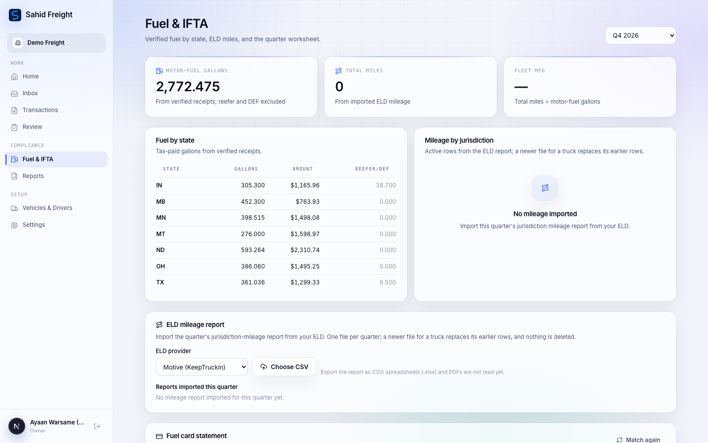

- **Motor-fuel gallons** come from verified receipts only. Reefer fuel and DEF are shown separately and never count.
- **Fuel by state**: tax-paid gallons and dollars by jurisdiction.
- **Mileage by jurisdiction**: from your ELD import, by state or by truck.

### 9.1 Fuel card statement

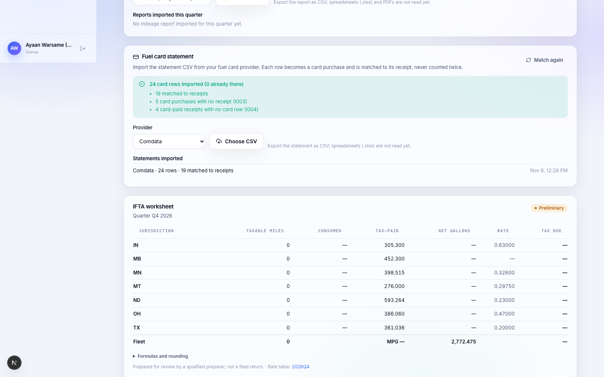

1. Choose the **provider** (Comdata, WEX/EFS, AtoB, TCS or generic).
2. **Choose CSV**. Export the statement as CSV from your provider; spreadsheets are not read yet.
3. Confirm **which column is which**. The system guesses from the headers and remembers your choice for that provider.
4. **Import**. Every row becomes a card purchase and is matched to its receipt by date, amount, gallons and truck. The result shows rows imported, how many matched, how many card purchases have no receipt (I003) and how many card-paid receipts have no card row (I004). **Match again** re-runs the matching after new receipts arrive.

Card rows corroborate receipts. They never replace a receipt and are never counted as a second purchase.

### 9.2 ELD mileage report

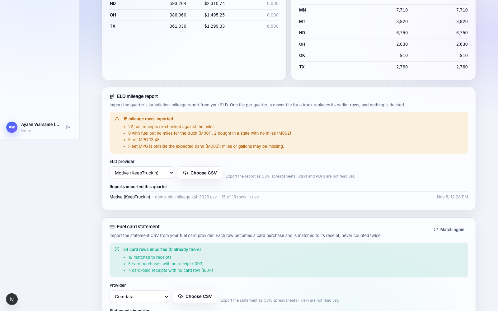

1. Choose the **ELD provider** (Motive, Samsara, Geotab, Omnitracs or generic).
2. **Choose CSV** and pick the **layout**: one row per truck and state, or one row per truck with a column per state. Distances can be miles or kilometres.
3. Confirm the columns. Trucks that are not in your fleet are listed; add them under Vehicles or fix the unit numbers in the file. Nothing is imported until every row is right.
4. **Import**. A newer file for a truck replaces its earlier rows, and the replaced rows are kept for the audit trail. Every fuel receipt is then re-checked against the miles (M001, M002, M003).

### 9.3 The worksheet

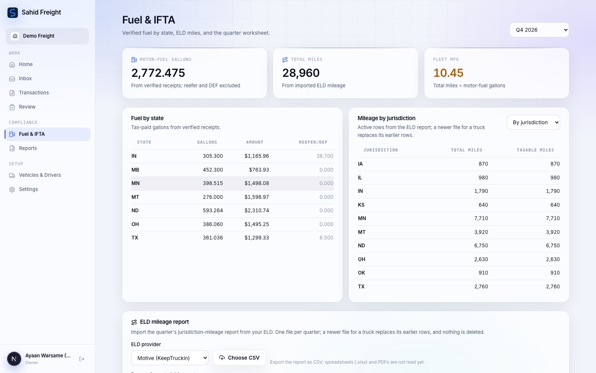

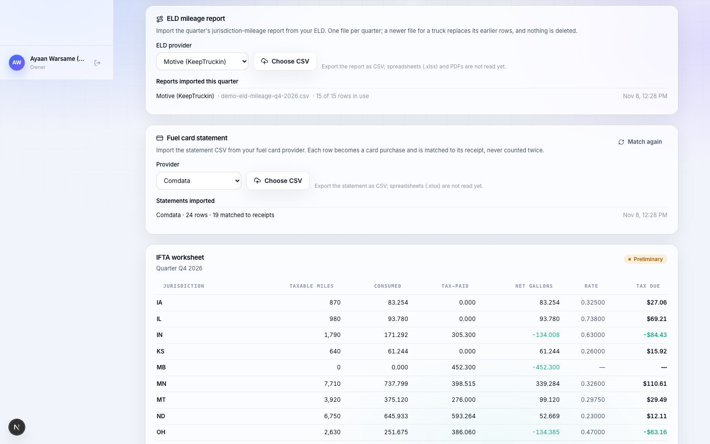

With fuel and miles in, the worksheet calculates each jurisdiction:

- **Taxable miles** from the ELD report.
- **Consumed** = taxable miles ÷ fleet MPG (fleet MPG = total miles ÷ motor-fuel gallons).
- **Tax-paid** gallons from verified receipts.
- **Net gallons** = consumed − tax-paid. Negative is a credit.
- **Rate** from the official quarterly rate table (source and version shown under the sheet).
- **Tax due** = net gallons × rate.

Expand **Formulas and rounding** for the exact arithmetic. The sheet is labelled **Preliminary**
and carries the line *Prepared for review by a qualified preparer; not a filed return.* If the rate
table for the quarter has not been loaded, the worksheet is blocked with notice I001 instead of
showing numbers.

---

## 10. Reports: what you hand over

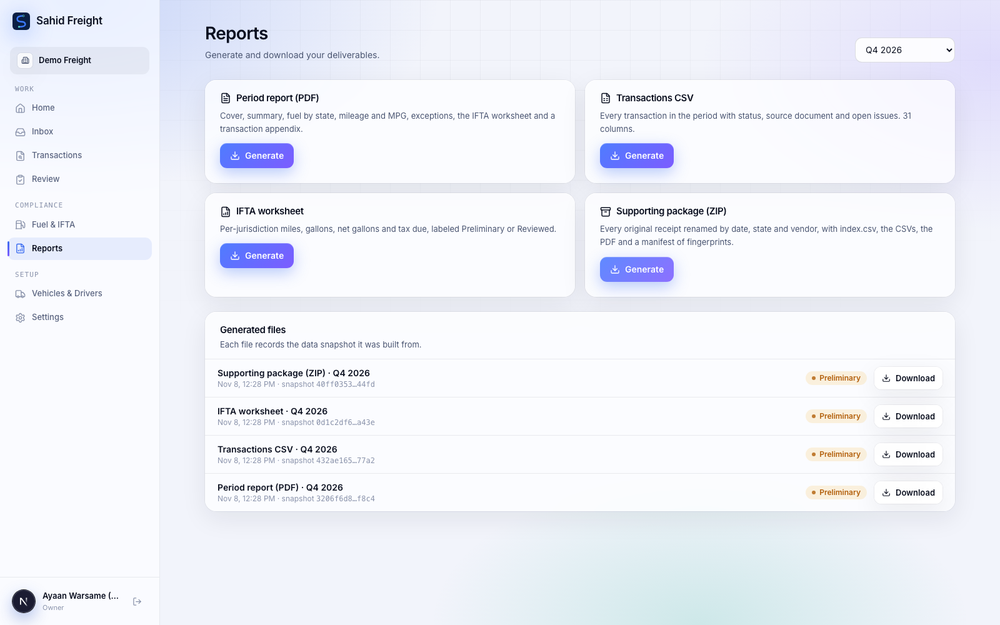

Pick the period and generate any of the four files. Each records the **snapshot** of data it was built
from, so it can be regenerated identically later, and stays labelled *Preliminary* until the period has
been reviewed.

| File | Contents |
|---|---|
| **Period report (PDF)** | Cover, summary, fuel by state, mileage and MPG, exceptions, the IFTA worksheet, transaction appendix |
| **Transactions CSV** | Every transaction in the period with status, source document and open issues (31 columns) |
| **IFTA worksheet** | Per-jurisdiction miles, gallons, net gallons and tax due |
| **Supporting package (ZIP)** | Every original receipt renamed by date, state and vendor, with index.csv, the CSVs, the PDF and a manifest of fingerprints |

Send the package to your preparer. The PDF and the ZIP are what an auditor would ask for.

---

## 11. The phone

Drivers use the Sahid Freight capture app or plain text messages to send receipts. In the app, **Send
a receipt** opens the camera: fuel, DEF, scale tickets and parking are all accepted. **Sent** shows
everything the driver has sent and where it stands. When a receipt has no unit number printed, the
driver is asked **Which truck?** and taps the one it was for. Uploads made without signal are kept on
the phone and sent when it reconnects.

The app is in test distribution and not yet in the app stores. Text messages and email work today.

---

## 12. A simple rhythm

| When | Do |
|---|---|
| **Every week** | Get the week's receipts in. Clear the Review queue. A few minutes. |
| **Every month** | Import the fuel card statement. Chase the I003 receipts. |
| **Quarter end** | Import the ELD mileage. Read the worksheet. Generate the four reports. Send the package to your preparer. |
| **Any time** | Add a truck or driver when the fleet changes. |

IFTA returns are due the last day of the month after the quarter ends: April 30, July 31,
October 31 and January 31. Home counts down to the next one.

---

## 13. Questions people ask

**A receipt shows the wrong date or no date.** Open it in Review, read the date off the receipt image
and type it with the pencil. If the reader simply misread it, **Re-read receipt** usually fixes it.

**The same receipt shows twice.** If the file was uploaded twice, the second copy is already marked as
a duplicate and is not counted. If two different files show the same purchase, flag D002 marks the
second; confirm which one is real and accept the other as a duplicate.

**Fleet MPG is amber.** Miles or gallons are missing. Check that every truck's ELD rows were imported
and every fuel receipt for the quarter is in.

**The worksheet says the rate table is not loaded.** The official matrix for that quarter has not been
loaded yet. Rates are never estimated, so the worksheet waits.

**Can I delete a receipt?** No. Documents are kept for four years, which is the IFTA record-keeping
requirement. A wrong or duplicate receipt is marked as such and excluded, not deleted.

**Who can see my data?** Only the people under Settings → Team for your company. Every query in the
system is scoped to your company.

---

## 14. Glossary

- **IFTA**: International Fuel Tax Agreement. Carriers file one quarterly return with their base state, which distributes fuel tax among the jurisdictions where the miles were driven.
- **Jurisdiction**: a U.S. state or Canadian province that is an IFTA member.
- **Tax-paid gallons**: fuel bought at the pump with tax included, proven by receipts.
- **Consumed gallons**: the fuel a jurisdiction's miles would have used at your fleet MPG.
- **Net gallons**: consumed minus tax-paid; positive means tax owed, negative means a credit.
- **Reefer fuel**: fuel for a refrigeration unit. Not motor fuel; excluded from IFTA.
- **DEF**: diesel exhaust fluid. Not fuel; excluded.
- **ELD**: electronic logging device; the source of jurisdiction mileage.
- **Fingerprint**: the SHA-256 hash of a file, used to prove the original was not changed and to detect duplicates.
- **Snapshot**: the recorded state of the data a report was built from.
